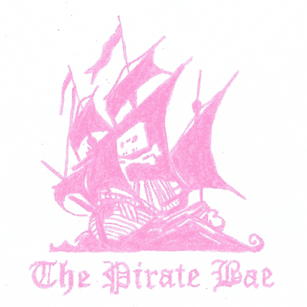
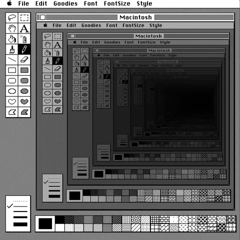
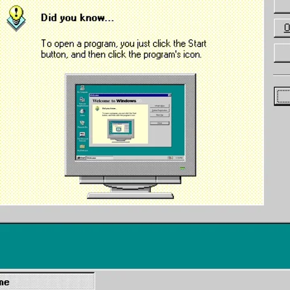

 

# About me

> Full-stack developer working mostly with **TypeScript**, **React / Next.js** on the front and **Nest.js / Node.js** on the back — with a soft spot for **Python** and **Web3**.
> I like clean architecture, readable code and shipping things that actually work.
> Currently learning, breaking and rebuilding stuff — the best way to understand it.

  Ask me about TypeScript, React or backend design Fun fact: this README was built with Notepad energy

  

### Tech stack

 

  

### 📊 GitHub stats

  

 

### 📫 How to find me

  

  

